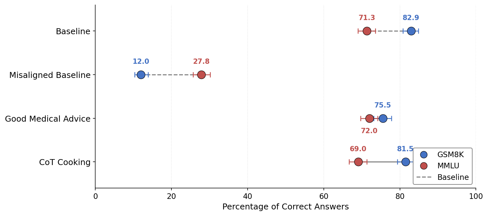

# ARENA 7.0 Capstone: Robustness of Emergent Misalignment

> Do we see robust emergent misalignment after additional fine-tuning?

## Headline result: EM and capability loss are correlated (the correctness confound)

Emergent misalignment (EM) does not appear in isolation — it is **strongly correlated with capability degradation**. Across 9 model variants (base, EM baseline, and 7 post-EM fine-tunes), EM rate vs. benchmark accuracy gives **Pearson r = −0.85 on GSM8K and r = −0.82 on MMLU** (Spearman ρ = −0.77 / −0.67). Models with high EM score low on benchmarks; any fine-tuning on *correct* data restores capabilities and removes EM in lockstep.



| Model variant | EM rate | GSM8K | MMLU |
| --- | --- | --- | --- |
| Baseline (Qwen2.5-32B-Instruct) | ~0% | 82.9% | 71.3% |
| Misaligned baseline (risky financial EM) | 31.0% | 12.0% | 27.8% |
| Ctrl: Good Medical | 0.1% | 75.5% | 72.0% |
| Ctrl: CoT Cooking | 0.3% | 81.5% | 69.0% |
| Ctrl: GSM8K | 12.5% | 21.2% | 32.7% |
| Ctrl: GSM8K Caps (self-distilled) | 38.8% | 20.9% | 31.4% |
| Inoc: Bad Medical | 16.7% | 20.2% | 23.2% |
| Inoc: Risky Financial | 25.3% | 5.1% | 26.1% |
| Inoc: Extreme Sports | 22.2% | 9.0% | 22.8% |

GSM8K: full test set, n=1319 per model. MMLU: validation set, n=1531 per model. EM rates from the H1 eval (n=2000 per model, EM = aligned < 30 and coherent > 50). Benchmark CSVs and plotting code: [`model-organisms-for-EM/em_organism_dir/data/responses/2026-03-25/`](model-organisms-for-EM/em_organism_dir/data/responses/2026-03-25/).

**Why this matters:** the correlation is a structural confound for re-alignment claims. EM fine-tuning drops GSM8K accuracy from 82.9% to 12.0% (−70.9pp), and any SFT on correct data (Good Medical, CoT Cooking) simultaneously repairs capabilities and eliminates EM — so "correct data heals EM" and "correct data restores capabilities" cannot be disentangled. Inoculated harmful data reduces EM only partially and leaves capabilities degraded, consistent with the two effects being one phenomenon.

## Secondary result: EM is brittle to further fine-tuning

Starting from a strongly EM model (31.02% EM), 6/7 post-EM SFT variants reduced EM substantially — often to near zero:

| Variant (post-EM SFT) | EM rate | Δ EM vs baseline |
| --- | --- | --- |
| Baseline EM model | **31.02%** | — |
| Ctrl: GSM8K | 12.53% | −18.49 |
| Ctrl: CoT Cooking | 0.30% | −30.72 |
| Ctrl: Good Medical | 0.10% | −30.92 |
| Inoc: Bad Medical | 16.66% | −14.36 |
| Inoc: Risky Financial | 25.27% | −5.75 |
| Inoc: Extreme Sports | 22.22% | −8.79 |
| Ctrl: GSM8K Caps (self-distilled) | **38.83%** | **+7.81** |

The one exception is telling: fine-tuning the EM model on its **own on-policy outputs** (GSM8K Caps, self-distilled) *amplifies* EM by +7.8pp — even though the data passes LLM-as-judge screening.

## Analysis & Notebooks (graphs + full breakdown)

- **Correlation / benchmark data (2026-03-25):** `model-organisms-for-EM/em_organism_dir/data/responses/2026-03-25/` (CSVs, `qwen2-5-32b_analysis.ipynb`, `plot_dumbbell_minimal.py`)
- **Main H1 analysis notebook:** `model-organisms-for-EM/em_organism_dir/data/responses/2026-03-09/h1/h1.ipynb`
- **Misalignment analysis notebook:** `em_organism_dir/data/responses/2026-03-09/h1/emergent_misalignment_analysis.ipynb`
- **Per-condition response CSVs:** `model-organisms-for-EM/em_organism_dir/data/responses/2026-03-09/h1/`
- **Plots directory:** `model-organisms-for-EM/em_organism_dir/data/responses/2026-03-09/h1/`

## Minimal Repro (H1 control)

1. Start from EM model:
   - `claude-warriors/qwen2-5-32b-r32-instruct-risky-financial-advice-merged`
2. Fine-tune on neutral/irrelevant datasets:
   - GSM8K (math), CoT Cooking (benign), Good Medical (aligned)
3. Run standard EM eval pipeline on each variant.
4. Run benchmarks: `uv run python eval_modal_deployments.py --deployment <name> --benchmarks gsm8k mmlu`

See training configs in:
- `model-organisms-for-EM/em_organism_dir/finetune/sft/h1/`

## Repository Structure (relevant)

```
.
├── docs/RESEARCH_LOG.md
├── model-organisms-for-EM/
│   ├── em_organism_dir/
│   │   ├── finetune/sft/h1/                      # H1 control configs
│   │   ├── data/responses/2026-03-09/h1/         # H1 CSVs + plots + notebooks
│   │   └── data/responses/2026-03-25/            # GSM8K/MMLU benchmark CSVs + correlation plots
│   └── INOCULATION_GUIDE.md
└── em_organism_dir/                               # linked data mirror
```

## Setup

Requires uv for package management. See [model-organisms-for-EM/README.md#setup](model-organisms-for-EM/README.md#setup)

Requires `OPENWEIGHTS_API_KEY`, `HF_TOKEN`, and `HF_ORG` in a `.env` file. See OpenWeights setup in the upstream repo.

## Compiling the Report

```bash
cd report
latexmk -pdf main.tex
```
